# React + Vite Deployment on AWS EC2 with Nginx

**Linux server administration · Cloud deployment · Networking · Monitoring · Incident recovery**

This repository documents my **DevOps Micro Internship (DMI) Cohort 2 — Week 2** practical work (23 January 2026). I deployed a React + Vite demo application to an **Ubuntu-based AWS EC2 instance**, configured **Nginx** to serve the production build, and carried out a production-style operations and troubleshooting drill on the server.

> **Scope:** This write-up covers **Assignment 2 (React deployment)** and **Assignment 3 (Production Maintenance / OPS Checklist)** from my Week 2 submission. It documents a hands-on training deployment, **not** a production-hardened service or automated CI/CD pipeline.

## Tech stack

| Component | Used for |
| --- | --- |
| **AWS EC2** | Remote Linux virtual machine |
| **Ubuntu Linux** | Hosting, shell and server administration |
| **React + Vite** | Demo application and static production build |
| **Node.js / npm** | JavaScript toolchain and build |
| **Nginx** | Static web serving on HTTP port 80 |
| **Git / GitHub** | Source-code version control and cloning |
| **SSH, systemd, curl and Linux CLI tools** | Remote operations, verification and troubleshooting |

**Versions recorded in the lab screenshots:** Node.js `v18.19.1`, npm `9.2.0`, Nginx `1.24.0 (Ubuntu)`, and Vite `7.3.1`.

## Architecture

```text
             Browser (HTTP)
                   |
                   v
             AWS EC2 VM
               (Ubuntu)
                   |
                   v
           Nginx :80 (HTTP)
                   |
                   v
            /var/www/html/
            Vite dist/ files
                   |
                   v
              React UI
```

The React demo displayed my name and the deployment date in the browser. The application was built into Vite's `dist/` directory and copied to the Nginx web root.

## 1. Application deployment

### Source and app customization

For the original January 2026 lab, I cloned my earlier GitHub repository to the EC2 instance and worked in its `react-assignment` project directory. This portfolio repository documents that deployment and the subsequent operations drill.

```bash
git clone https://github.com/slim274/React--DevOp.git
cd React--DevOp/react-assignment
```

I edited `src/App.jsx` to display my name and the date (**23-01-2026**), confirming that the deployed page used my customized React component.

**Evidence — repository cloned to EC2:**

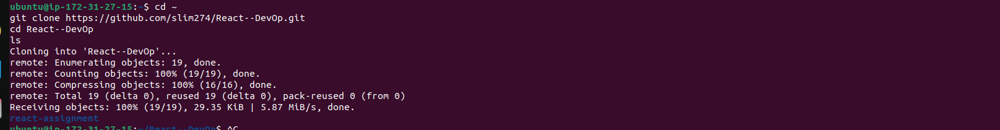

**Evidence — React component customized:**

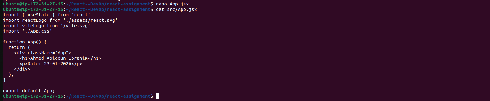

### Build and publish through Nginx

The deployment screenshots show these commands and a successful Vite build:

```bash
npm run build
ls dist
sudo cp -r dist/* /var/www/html/
sudo systemctl restart nginx
```

The Vite output shows **37 modules transformed** and a completed production build. The `dist/` folder contained `index.html` and an `assets/` directory.

**Evidence — successful Vite production build:**

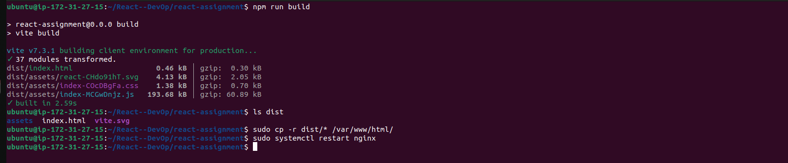

I then validated and checked the Nginx service:

```bash
sudo nginx -t
sudo systemctl restart nginx
sudo systemctl status nginx
```

Nginx reported that its configuration test was successful and the service was **active (running)**. Opening the EC2 public HTTP address in a browser displayed the React application.

**Evidence — Nginx validation and service status:**

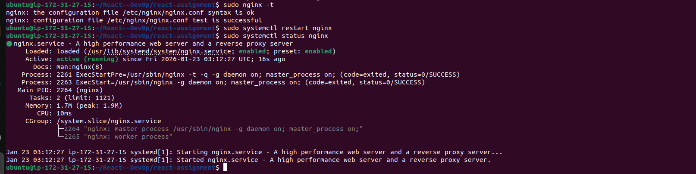

**Evidence — deployed React application accessible in the browser:**

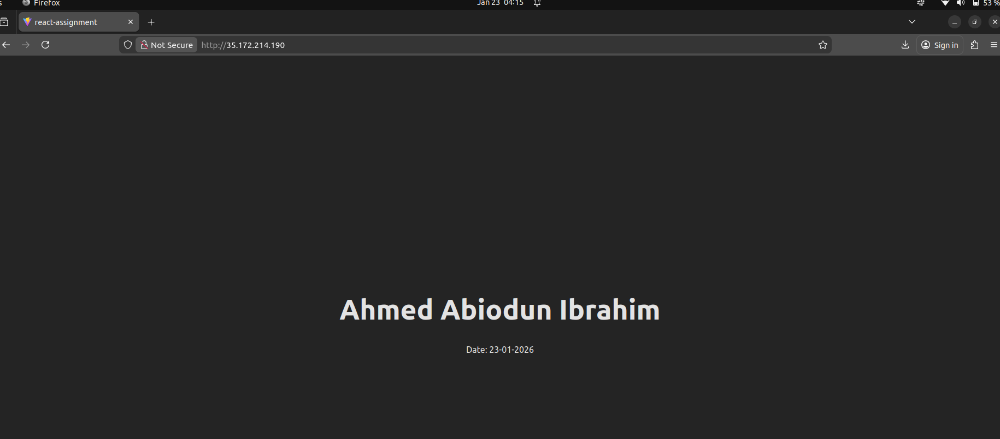

## 2. Network and server operations checks

After the deployment, I performed a structured Linux operations drill to verify connectivity, service health, logs, system resources and application configuration.

| Check | Commands/tools used | Evidence and observation |
| --- | --- | --- |
| Network interfaces and routing | `ip addr`, `ip route` | Inspected the host interfaces and default gateway. |
| DNS and external connectivity | `nslookup google.com`, `ping -c 4 google.com` | DNS resolution succeeded; the ping screenshot shows **4 received / 0% packet loss**. |
| Listening ports and owning processes | `sudo ss -tulnp` | Nginx was listening on **TCP 80**; SSH was listening on **TCP 22**. |
| Host firewall status | `sudo ufw status` | Reported **`Status: inactive`** during this exercise. |
| Service validation | `sudo systemctl status nginx`, `sudo systemctl is-enabled nginx`, `sudo nginx -t` | Checked running state, startup enablement and configuration validity. |
| Process inspection | `ps -ef \| grep nginx`, port/process checks | Identified Nginx master and worker processes. |
| HTTP request and access logs | `curl http://localhost`, `sudo tail -n 5 /var/log/nginx/access.log` | Generated a local HTTP request and inspected recent access-log entries. |
| System resources | `uptime`, `top`, disk-usage and directory-size checks | Reviewed load/uptime, CPU, memory, disk space and usage under `/var`. |
| Content / routing | Web-root checks, Nginx config review, `curl` | Verified deployed static files and tested SPA fallback behavior. |

> **Security note:** The screenshot explicitly shows **UFW was inactive**. I documented that finding rather than claiming the instance had an enabled host firewall. This was an HTTP lab deployment; production hardening would require appropriate AWS security-group restrictions, host firewall policy as needed, HTTPS/TLS and ongoing maintenance.

### Network and server evidence

**Network routing, DNS and connectivity:**

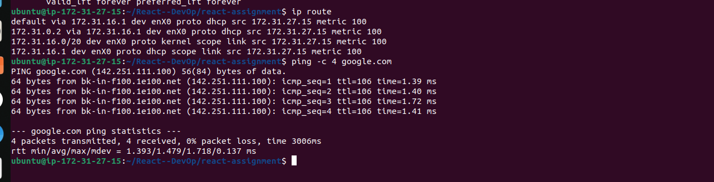

**Listening ports and processes:**

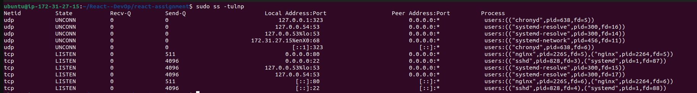

**UFW firewall status:**

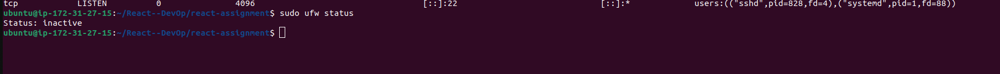

## 3. Nginx SPA routing validation

I inspected `/etc/nginx/sites-available/default` and confirmed that Nginx served the compiled application from `/var/www/html`, with a single-page application fallback to `index.html`:

```nginx
server {
    listen 80 default_server;
    listen [::]:80 default_server;

    root /var/www/html;
    index index.html index.htm;
    server_name _;

    location / {
        try_files $uri /index.html;
    }
}
```

I used `curl` to request the server root and example paths such as `/about` and `/contact`. The responses returned the app's `index.html` shell, confirming that Nginx routed these requests to the SPA entry point. **This verifies server fallback, not that the React app implements those specific pages.**

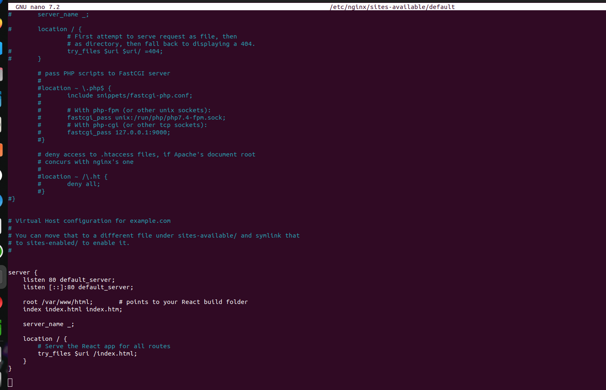

## 4. Incident simulation and recovery

I deliberately introduced a syntax error into the Nginx site configuration to practice safe error detection and recovery.

1. Edited `/etc/nginx/sites-available/default` and removed a closing brace during the simulation.
2. Ran `sudo nginx -t`; Nginx returned **`unexpected end of file, expecting "}"`** (reported against `/etc/nginx/sites-enabled/default`).
3. Corrected the configuration and reran `sudo nginx -t`; the test succeeded.
4. Ran `sudo systemctl restart nginx` followed by `sudo systemctl status nginx`.
5. Confirmed that Nginx returned to **`active (running)`**.

This drill demonstrated configuration validation, error interpretation and controlled recovery without relying on trial-and-error restarts.

**Evidence — deliberate configuration failure and successful validation after correction:**

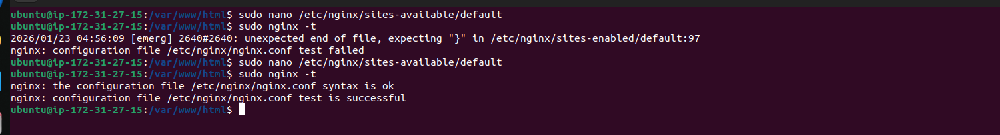

**Evidence — Nginx service restored:**

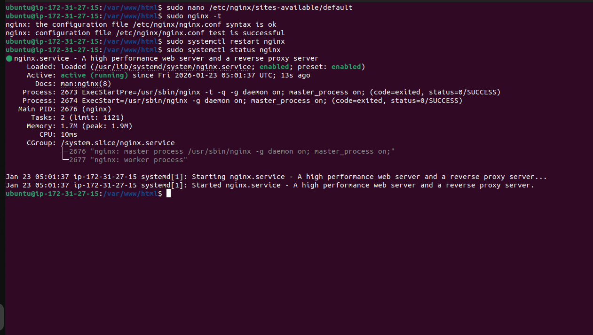

## Result

- Deployed a customized **React + Vite** application to an **AWS EC2 Ubuntu VM** using **Nginx**.
- Verified the production build and browser accessibility over HTTP.
- Practiced network troubleshooting, port and process inspection, service monitoring, HTTP log review and Linux resource checks.
- Tested Nginx SPA fallback configuration.
- Simulated a web-server configuration error, fixed it and confirmed successful service recovery.

## Skills demonstrated

`AWS EC2` · `Ubuntu Linux` · `Nginx` · `React` · `Vite` · `Git` · `SSH` · `DNS` · `TCP/IP` · `Linux CLI` · `systemd` · `Log Analysis` · `Troubleshooting` · `Incident Recovery`

## Repository notes

- During the lab, I worked in a directory called `react-assignment`. In this GitHub repository, the React source is stored at the repository root.
- The `screenshots/` folder contains selected evidence extracted from my Week 2 assignment report.
- The public IP and service status shown in January 2026 screenshots represent the **historical lab**, not a guarantee that the instance is currently running.
- This project did **not** demonstrate Terraform, Docker, CI/CD, HTTPS configuration or a fully hardened production environment; those are possible future improvements.

## Author

**Ibrahim Ahmed Abiodun**  
GitHub: [@slim274](https://github.com/slim274)

**Training:** DevOps Micro Internship (DMI), Cohort 2 — Week 2: *Linux for DevOps*.
